# ShadeShift

> **A local satellite-data experiment in Thủ Đức: which heat and land-cover signals are stable enough to support urban-cooling investigation?**

**ShadeShift** is a NASA Space Apps 2026 project built around a deliberately small pilot in Ho Chi Minh City. Instead of starting from the assumption that every available satellite layer should become part of a heat-risk score, we treated the pilot as an experiment:

1. map the current surface;
2. test thermal signals across time;
3. reject evidence that does not remain stable;
4. audit spatial artefacts;
5. rank only cells that survive those checks;
6. keep uncertainty visible in the product.

The result is **not a citywide heat-risk model and not a tree-placement prescription**. It is an evidence-aware shortlist of 500 m planning cells within a frozen ~14.7 km² pilot area in Thủ Đức.

Deployed Demo Link: [Visit ShadeShift on Vercel](https://shadeshift-web.vercel.app/)

Technical Deck: [Google Slides Report](https://docs.google.com/presentation/d/1BEc2-QNeBtph45A72QTBWgVVwaHT-HerhCj8Mrd8zzk/edit?slide=id.h713b306abf83e1c1_3_35#slide=id.h713b306abf83e1c1_3_35)

Demo Video: [Video Here](https://drive.google.com/file/d/1V09Ebv6n4PIyC0TpL0yVg9VPUO2rQvXt/view?usp=sharing)

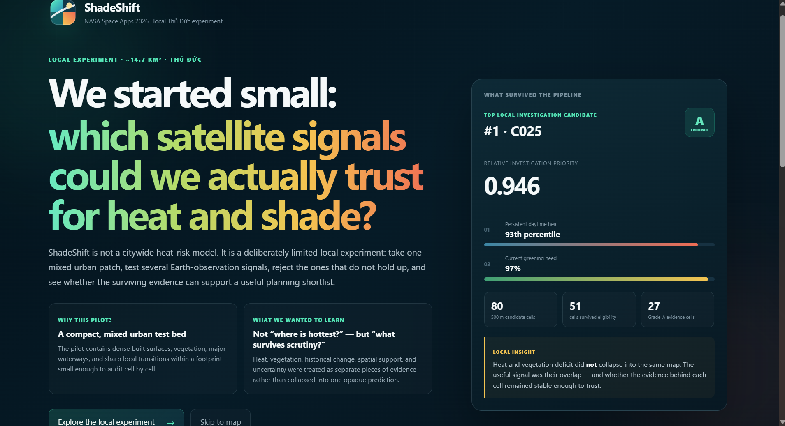

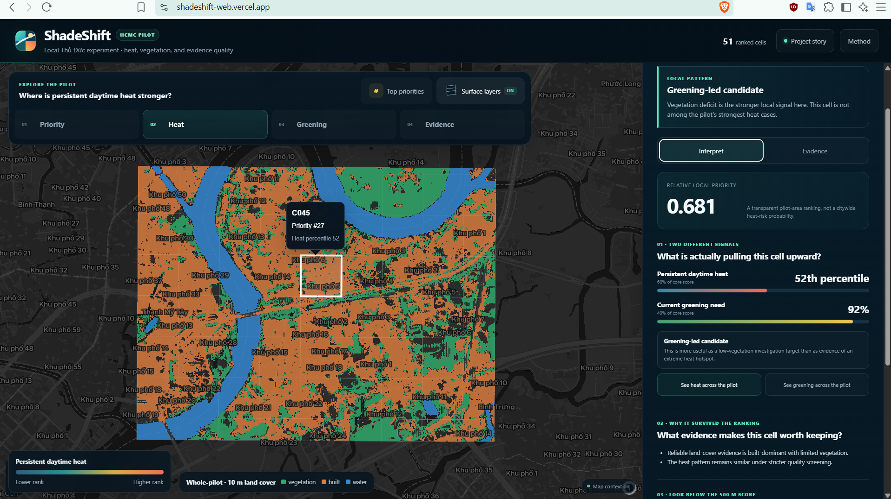

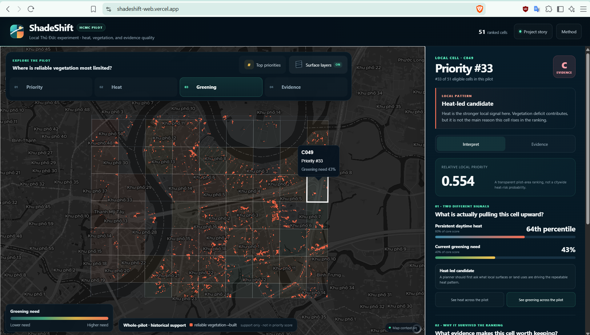

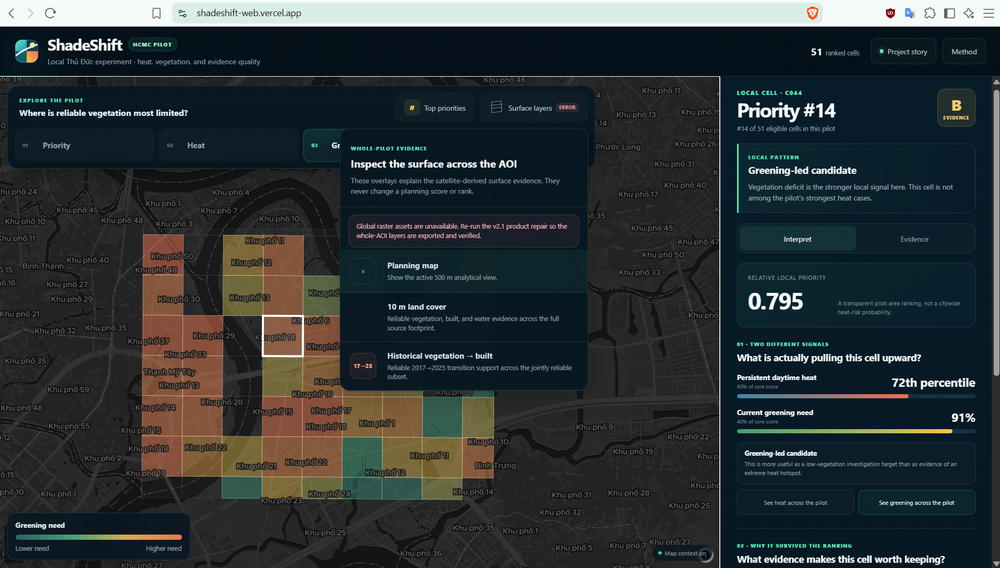

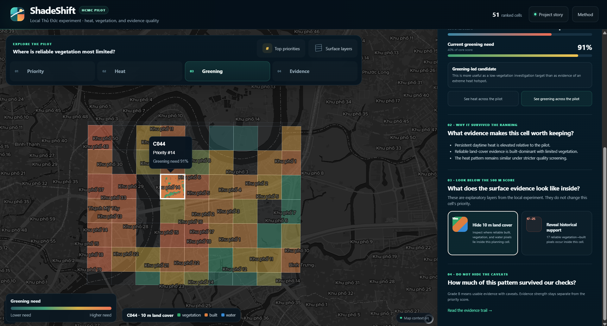

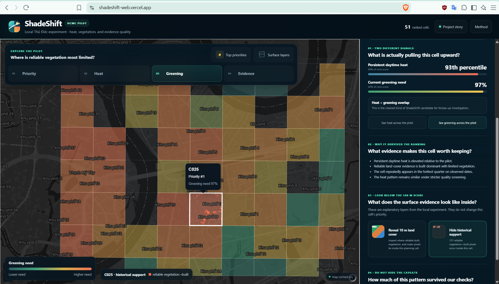

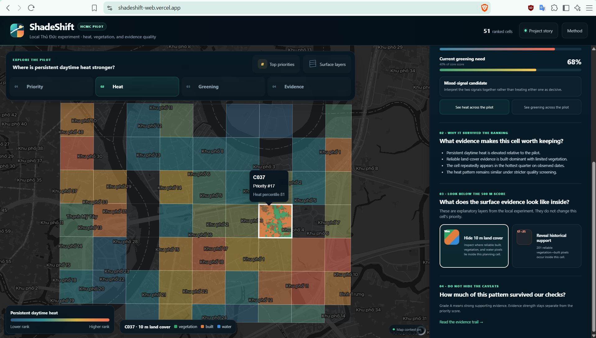

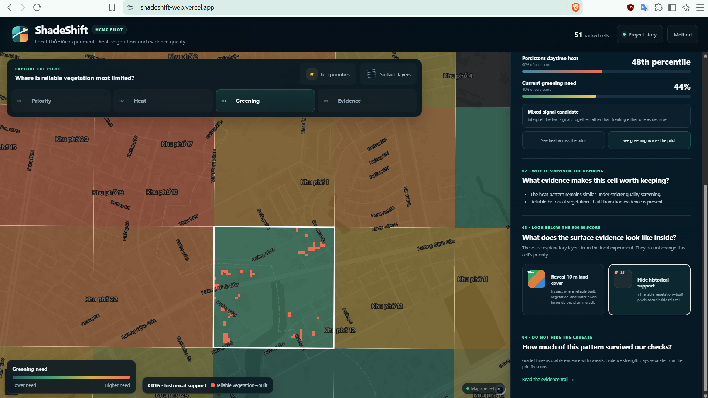

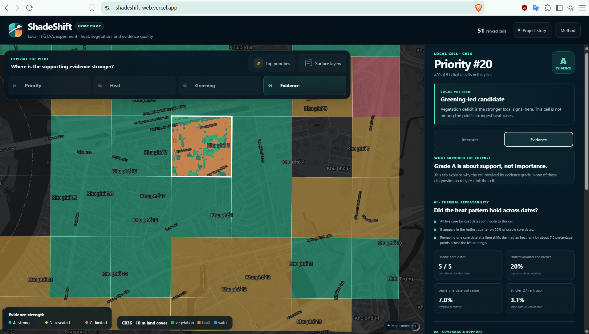

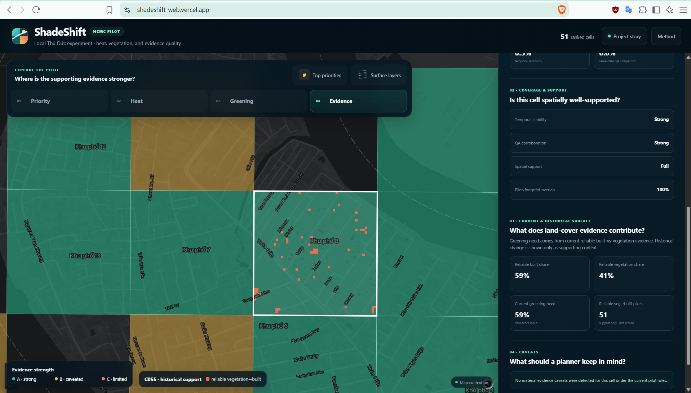

---

## Why we built it this way

The obvious version of this idea is easy: overlay a heat map with vegetation and color the “worst” areas red.

That was not the interesting part.

Our real question became:

> **Given limited urban-greening resources, which parts of this local pilot should planners investigate first — and what satellite evidence actually supports that prioritization?**

That required us to separate three things that are often collapsed together:

- **persistent daytime heat**;
- **current greening need**;
- **how strongly the evidence supports the cell**.

Those are intentionally different concepts in ShadeShift.

A cell can be:

- **heat-led** — relatively hot without being exceptionally vegetation-poor;
- **greening-led** — vegetation-poor without being a recurrent extreme-heat cell;
- **an overlap case** — both signals are high;
- **well ranked but caveated** — useful to investigate, but with weaker temporal or spatial support.

This distinction became one of the most useful findings of the pilot.

---

## Pilot at a glance

| Item | Final pilot |
| --- | --- |
| Study area | ~14.7 km² local pilot in Thủ Đức, Ho Chi Minh City |
| Planning scale | 500 m cells |
| Initial planning cells | 80 |
| Spatially supported cells (`>=50%` footprint) | 62 |
| Final eligible/ranked cells | 51 |
| Evidence grades | 27 A / 22 B / 2 C |
| Core heat evidence | Landsat 8/9 daytime Surface Temperature |
| Current land cover | OlmoEarth v1.3 annual 10 m embeddings |
| Historical support | reliable 2017→2025 vegetation→built transitions |
| ECOSTRESS role | contextual only — rejected as a persistent core heat signal |
| Core score | `0.60 × heat_score + 0.40 × greening_need` |

The current top local candidate is **C025**: approximately the **93rd percentile for persistent daytime heat** and **97% greening need**, with **Grade-A supporting evidence**.

The score is a **relative investigation priority inside this frozen pilot**, not a calibrated probability of heat-health risk.

---

## What happened during the experiment

### 1. We used OlmoEarth to map the current surface

We used **OlmoEarth v1.3 annual 10 m embeddings** to build a deliberately simple three-class land-cover classifier:

- vegetation;
- built;
- water.

Unsupported or low-confidence pixels remain unknown rather than being forced into a class.

The frozen classifier is logistic regression with feature scaling. Under the weak multi-source consensus protocol:

- held-out test macro-F1: **0.958**;
- 200 group-aware holdouts: mean macro-F1 **0.948**;
- grouped-CV permutation test: empirical **p = 0.0033**;
- 2017 weak-label control agreement: **0.982**.

These numbers measure agreement with our **weak multi-source consensus labels**, not independent human ground truth.

The land-cover model is used to derive current greening need and to expose 10 m explanatory layers in the product. It is **not** a live arbitrary-image classifier.

---

### 2. ECOSTRESS looked promising — then failed our persistence test

We initially evaluated NASA **ECOSTRESS V002** Land Surface Temperature observations.

The useful nighttime observations were real, but their relative hotspot patterns were not temporally stable enough for the role we wanted.

At 500 m, the three core ECOSTRESS pairwise Spearman correlations were approximately:

- `0.315`;
- `-0.279`;
- `-0.076`.

The partial holdout also disagreed with the core median.

So we did **not** keep searching for a scene that looked better.

We froze the result:

> **ECOSTRESS remains contextual nighttime NASA evidence, but is not a core priority input.**

That negative result materially changed the product.

---

### 3. Landsat survived the same question

We then audited **Landsat 8/9 Collection 2 Level-2 Surface Temperature**.

Core dates were selected **before** repeatability testing using coverage and quality criteria, so the final set was not chosen by looking for dates that agreed.

Five moderate-QA core acquisitions were retained:

- Jan 19;
- Feb 4;
- Feb 28;
- Mar 24;
- Apr 25.

At the 500 m planning scale:

- median pairwise Spearman: **0.664**;
- mean pairwise Spearman: **0.676**;
- mean pairwise Pearson: **0.745**;
- leave-one-date-out comparisons remained broadly positive;
- two independent partial dates also agreed strongly with the core consensus.

A stricter guarded-QA subset was even more consistent:

- mean Spearman: **0.781**;
- mean Pearson: **0.804**.

That was strong enough to promote the multi-date Landsat signal to the thermal core.

We use **relative percentile-rank consensus**, not precise neighborhood temperature claims. Landsat's 30 m product grid does not imply independent 30 m thermal information.

---

### 4. We caught our own spatial ranking bug

An early 500 m ranking produced suspicious extreme boundary cells.

A geometry audit revealed why: some full 500 m polygons overlapped the actual evidence footprint by only a tiny sliver. One apparent high-priority cell had only about **0.3%** of its nominal footprint represented.

Across the 80 planning cells:

- 18 had `<50%` evidence-footprint overlap;
- only 62 met the spatial-support rule.

Six of the then-current Top 10 were sliver cells.

We reopened the supposedly finished ranking, added an explicit footprint-overlap guard, and recomputed thermal percentile ranks only over spatially supported cells.

After the correction:

- spatially supported: **62**;
- final eligible: **51**;
- weight sensitivity remained strong;
- QA-tier heat agreement remained strong.

This correction is part of the project story because it changed which cells we were willing to show as planning priorities.

---

### 5. We kept priority separate from evidence strength

The frozen core score is intentionally transparent:

\[
\text{priority} =
0.60 \times \text{persistent daytime heat rank}
+
0.40 \times \text{current greening need}
\]

where:

- **heat score** = median of per-date 500 m within-pilot percentile ranks across validated Landsat core dates;
- **greening need** = reliable built share relative to built + vegetation.

Historical vegetation→built change is **supporting evidence only**.

A second audit adds product-facing evidence grades using:

- temporal stability;
- same-date stricter-QA corroboration;
- spatial support.

Final eligible-cell evidence grades:

- **A: 27**
- **B: 22**
- **C: 2**

Evidence grade never modifies `priority_core` or `priority_rank`.

---

## What ShadeShift actually contributes

ShadeShift is not claiming that urban-heat mapping itself is new.

The contribution of this pilot is the **decision discipline around the data**:

```text
available satellite signal
        ↓
quality / coverage audit
        ↓
temporal repeatability test
        ↓
spatial-support audit
        ↓
survives? ───── no ───→ downgrade / contextualize
   │
  yes
   ↓
transparent planning signal
        ↓
evidence-strength diagnostics
        ↓
product that exposes both result and caveat
```

The product therefore tells a different story from a conventional heat dashboard:

> **More data is not automatically better. A useful planning layer should earn its role.**

---

## Product experience

The web product is designed for two levels of exploration.

### Whole-pilot questions

Users can compare:

1. **Priority** — where should planners investigate first?
2. **Heat** — where is persistent daytime heat stronger?
3. **Greening** — where is reliable vegetation more limited?
4. **Evidence** — where is the supporting evidence stronger or weaker?

### Surface evidence

Optional whole-pilot raster layers expose:

- 10 m built / vegetation / water evidence;
- reliable 2017→2025 vegetation→built support.

### Selected-cell interpretation

Selecting one 500 m cell explains whether it is:

- a heat + greening overlap case;
- heat-led;
- greening-led;
- mixed-signal.

The cell can then be opened down to its 10 m land-cover evidence and historical support.

### Evidence trail

The Evidence tab explains:

- usable core Landsat dates;
- hottest-quartile recurrence;
- leave-one-date-out sensitivity;
- stricter-QA agreement;
- footprint support;
- current land-cover composition;
- historical change support;
- caveats.

No hidden confidence value changes the ranking.

---

## Architecture

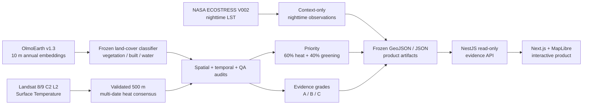

There is **no live Earth Engine or ML inference requirement in the demo**. The web application serves frozen validated evidence artifacts.

---

## Data sources

| Source | Role in ShadeShift | Final status |
| --- | --- | --- |
| **OlmoEarth v1.3** annual embeddings | 2025 current land cover; 2017 historical comparison | Core |
| **Landsat 8/9 Collection 2 Level-2 ST** | persistent daytime thermal consensus | Core |
| **NASA ECOSTRESS V002 LST** | nighttime thermal observations | Context only |
| **MapTiler / MapLibre** | geographic basemap and rendering | Product context |

The Landsat program is a joint USGS/NASA program. ECOSTRESS is a NASA mission.

---

## Repository layout

The exact science workspace contains generated and raw-data folders that are intentionally excluded from Git. The important source structure is:

```text
ShadeShift/
├─ product/
│  ├─ apps/
│  │  ├─ api/                  # NestJS read-only evidence API
│  │  └─ web/                  # Next.js + MapLibre product
│  ├─ packages/
│  │  └─ contracts/            # shared TypeScript/Zod contracts
│  ├─ scripts/                 # product asset preparation + verification
│  ├─ package.json
│  └─ .env.example
│
├─ scripts/                     # science / Gate C4 pipeline scripts
├─ config/                      # frozen pipeline configuration
├─ notes/                       # validation / provenance notes
│
├─ public/
│  └─ data/                     # small frozen product-ready artifacts
│
├─ data/                        # raw/intermediate rasters — not committed
├─ outputs/                     # generated science rasters — not committed
├─ logs/                        # local audit logs — not committed
└─ README.md
```

The small final GeoJSON/JSON artifacts needed by the API are suitable for version control. Large raw and intermediate raster products are not.

---

## Run the product locally

### Requirements

- Node.js **20.9+**
- npm
- Python **3.11+** for classifier-layer preparation / verification
- optional MapTiler browser key for the basemap

### 1. Clone

```bash
git clone https://github.com/alberttrann/ShadeShift.git
cd ShadeShift
```

### 2. Configure the product

On PowerShell:

```powershell
cd product
Copy-Item .env.example .env
```

The important variables are:

```env
PORT=4000
WEB_ORIGIN=http://localhost:3000
NEXT_PUBLIC_API_BASE_URL=http://localhost:4000/api/v1

# Optional:
NEXT_PUBLIC_MAPTILER_API_KEY=
```

If a MapTiler key is used, restrict it to the appropriate development and production origins.

### 3. Install

```bash
npm install
```

### 4. Prepare classifier visualization assets

If the source Gate-B rasters are available locally:

```bash
npm run prepare:classifier-layers
npm run verify:classifier-context
```

The product can also use committed product-ready derived assets when present.

### 5. Start

```bash
npm run dev
```

Then open:

- Web: `http://localhost:3000`
- API: `http://localhost:4000/api/v1`
- Swagger: `http://localhost:4000/docs`

---

## API

The backend is intentionally read-only.

```text
GET /api/v1/health
GET /api/v1/meta
GET /api/v1/cells
GET /api/v1/cells/:cellId
GET /api/v1/priorities/top
GET /api/v1/methodology
GET /api/v1/layers
```

Example filters include eligible cells, evidence grades, minimum priority, and spatial bounding boxes.

The API validates the frozen artifact contract at startup and exposes SHA-256 provenance for loaded artifacts.

---

## Re-running the final planning stage

After the upstream land-cover and Landsat evidence is available, the final ranking stages are:

```powershell
# From the ShadeShift science root:
.\scripts\run_gate_c4_final_v3.ps1

# Add evidence-strength diagnostics without changing priority:
.\scripts\run_gate_c4_1_caveat_audit.ps1
```

The spatial-fix pipeline must report:

```text
Gate C: PASSED
revision: C4-v3-spatial-fix
```

and the sensitivity audit should retain its registered robustness flags.

The product should consume the **enhanced C4.1 artifacts** where available.

---

## Validation summary

### Land-cover classifier

The land-cover metrics are agreement with a weak multi-source consensus protocol.

| Diagnostic | Result |
| --- | ---: |
| Held-out test macro-F1 | 0.958 |
| 200 group-aware holdouts, mean macro-F1 | 0.948 |
| Group-aware holdouts, 5th percentile | 0.880 |
| Grouped-CV permutation empirical p | 0.0033 |
| 2017 weak-label control agreement | 0.982 |

### Landsat thermal persistence

Moderate-QA core, 500 m:

| Diagnostic | Result |
| --- | ---: |
| Core dates | 5 |
| Median pairwise Spearman | 0.664 |
| Mean pairwise Spearman | 0.676 |
| Mean pairwise Pearson | 0.745 |

Guarded-QA core:

| Diagnostic | Result |
| --- | ---: |
| Core dates | 4 |
| Mean pairwise Spearman | 0.781 |
| Mean pairwise Pearson | 0.804 |

### Final planning-grid robustness

| Diagnostic | Result |
| --- | ---: |
| Candidate cells | 80 |
| Spatially supported | 62 |
| Eligible | 51 |
| Weight-sensitivity Spearman, worst tested scenario | 0.950 |
| Top-10 overlap, worst tested scenario | 0.80 |
| Moderate-vs-guarded heat Spearman | 0.982 |
| Median QA-tier heat gap | 0.0167 |

These are pilot diagnostics, not universal thresholds.

---

## Scientific boundaries

ShadeShift deliberately **does not** claim:

- citywide HCMC coverage;
- a calibrated heat-health risk probability;
- exact tree-placement sites;
- legal or ownership feasibility;
- causal cooling impact;
- independent 10 m thermal temperature;
- independent human ground-truth accuracy for the land-cover classifier;
- a stable ECOSTRESS hotspot map for this pilot.

A high-ranked cell means:

> **within this frozen local pilot, the cell combines relatively persistent daytime heat with current greening need strongly enough to be worth investigating first.**

That is all.

---

## Tech stack

**Science / geospatial**

- Python 3.11
- Rasterio
- GeoPandas
- NumPy / pandas
- scikit-learn
- Google Earth Engine exports for satellite preprocessing

**Product**

- Next.js
- TypeScript
- MapLibre GL
- MapTiler optional basemap
- NestJS
- Zod shared contracts

---

## Reproducibility notes

Raw satellite rasters and large intermediate outputs are intentionally excluded from GitHub.

The repository should contain:

- source code;
- frozen configuration;
- small product-ready GeoJSON/JSON artifacts;
- small derived frontend visualization assets when practical;
- provenance / validation summaries.

Do **not** commit:

- `.env` or API keys;
- `.venv/`;
- `node_modules/`;
- raw `.tif` satellite rasters;
- Earth Engine export caches;
- local audit logs;
- Python caches;
- Next.js build output.

See `.gitignore`.

---

## Acknowledgements

ShadeShift uses Earth-observation data and derived products from:

- NASA / USGS Landsat;
- NASA ECOSTRESS;
- OlmoEarth embeddings.

The project was built for the **NASA International Space Apps Challenge 2026**.
